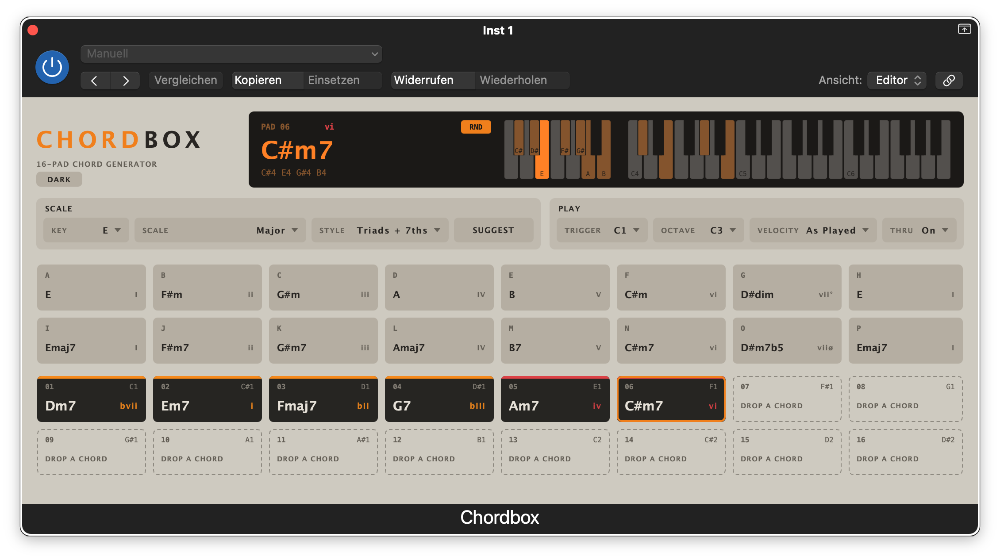
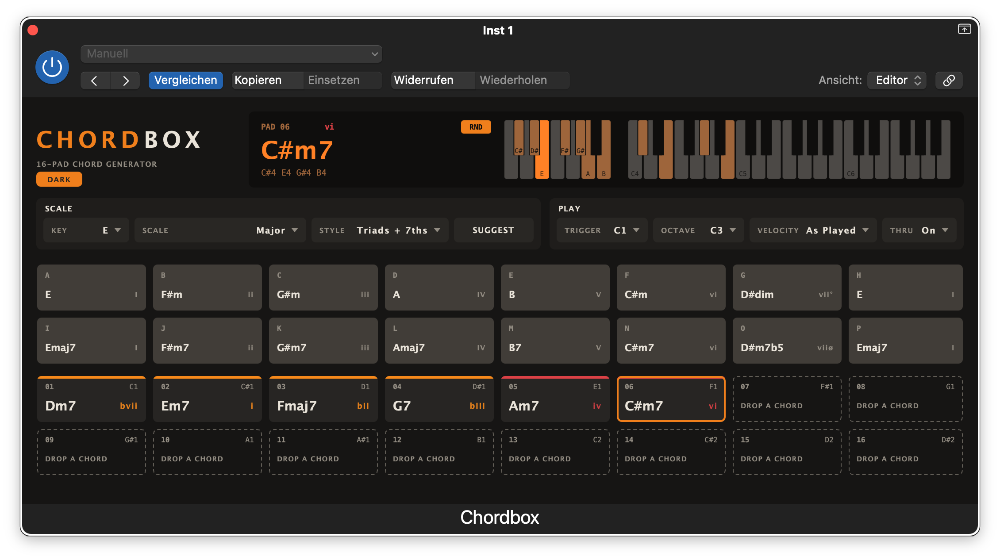

# Chordbox

A 16-pad chord generator for macOS: an AU MIDI effect (aumi/Chbx/Tzor) and a
standalone app, built with JUCE 9 on the panel of its sibling Kitbox.

Pick a key and a scale and press **Suggest**. Sixteen buffer tiles fill with
chords that fit, from plain triads and sevenths to sus and colour chords.
Drag the ones you want onto the sixteen playable pads, then change any pad by
hand, down to a Fmaj7sus2 in second inversion.

Family: [Kitbox](https://github.com/TZorr/Kitbox) (16-pad drum sampler), [Rackbox](https://github.com/TZorr/Rackbox) (four-slot multi-effect), [Rackbox Plus](https://github.com/TZorr/RackboxPlus) (the same rack, eight knobs per effect), [FMBox](https://github.com/TZorr/FMBox) (eight-sound FM drum synth), [Transmute](https://github.com/TZorr/Transmute) (drum resynthesis).





**Dark** under the wordmark switches the panel to dark; the choice is yours,
not the session's - every Chordbox window and project opens the way you left it.

## Install

Download `Chordbox.0.6.2.pkg` from
[Releases](https://github.com/TZorr/Chordbox/releases) and run it; the AU goes into `/Library/Audio/Plug-Ins/Components`. Apple Silicon, macOS
26.5 or later. The installer is unsigned, so Gatekeeper refuses it at first:
right-click it and choose Open, or allow it under System Settings › Privacy &
Security.

## In Logic

Chordbox makes no sound itself. Put it in a software instrument track's
**MIDI FX** slot, above the instrument. Keys C1-D#2 play pads 1-16. Every
other note passes through to the instrument while Thru is on, and so does
everything that is not a note.

## Pads

- **Click and hold** plays the chord. The higher up the pad you click, the
  louder it plays, as in Kitbox.
- **Right-click** chooses the pad's chord:
  - **In the key:** one submenu per degree, holding the chords that fit the
    scale on that root.
  - **All Chords:** every chord on every root.
  - **Inversion** and **Octave**.
  - **Clear Pad**.
- Each pad shows its chord, its degree in the key (`IV`, `vi`, `vii°`) and
  the note that plays it.
- An empty pad is drawn as a dashed outline that reads "DROP A CHORD".
- The display shows the chord last played or selected: its name, its notes
  and a keyboard with those notes marked.
  - To its left, set apart, one octave shows the key: the scale's notes are
    marked and named as the key spells them, and the root is brightest.

## Buffer

The two grey rows above the pads are the buffer: sixteen tiles, A-P.
**Suggest** fills them and never touches the pads. The pads start empty and
hold only what you put on them.

- **Drag a tile onto a pad** to copy the chord onto it. The tile keeps it, so
  one tile can fill several pads.
- **Drag a pad onto a tile** to copy its chord there, for example to keep it
  across the next Suggest.
- **Drag a pad onto a pad** to swap the two, or move it if the other pad is
  empty. Tiles do the same among themselves.
- **Click a tile** to hear its chord. Keys never play tiles.
- **Right-click a tile** and choose Clear Tile to empty it.
- **An empty pad** plays nothing. Its key does not pass through either.
- The buffer and the pads are saved with the session.

## RND

The small **RND** button in the display, top left beside the scale octave,
humanizes every chord. It works on each note separately:

- **Velocity** moves by up to ±12 %.
- **Timing** moves by up to ±8 ms. A MIDI effect cannot play a note before
  it arrives, so this is a delay of 0–16 ms centred on 8 ms.

Both are drawn from a triangular distribution. Most notes land near the
middle, and nothing goes beyond the limits. A note's note-off is delayed
exactly as much as its note-on, so nothing can hang.

RND is on by default. It is a parameter, so it can be automated, and it is
saved with the session.

## Settings

| | |
|---|---|
| **Key**, **Scale** | Major, Natural/Harmonic/Melodic Minor, the modes, Major/Minor Pentatonic. Chord names are spelt in the key (Bb in F major, never A#). Roots outside the key are spelt as the parallel key spells them (Ab in C major). A chord's notes are spelt from its root, so B7 is B D# F# A. Degrees outside the key read bIII, bVI, bVII … |
| **Style** | What **Suggest** fills the buffer with. Row 1 is degrees I-VII plus the octave, row 2 is the same degrees again. **Triads + 7ths**: C Dm Em F G Am Bdim C over Cmaj7 … Bm7b5. **Sus**: sus2/sus4, then 7sus4/maj7sus2. **Colour**: add9/madd9, then maj9/9/m9/m11 … **Sixths**: C6 Dm6 … over C6/9 Dmadd9 … **Jazz**: Cmaj9 Dm9 G9 … over C6/9 Dm11 Fmaj7#11 G13 … **Quartal**: stacked fourths and open sus chords. **Power**: C5 D5 … over sus2/sus4. **Borrowed**: the key's triads over the parallel key's (C major over Cm Ddim Eb Fm Gm Ab Bb). **Secondary Dominants**: the key's triads, each with the dominant seventh that leads to it underneath (G7 A7 B7 C7 D7 E7 F#7). |
| **Suggest** | Refills the sixteen buffer tiles. The pads are never touched. |
| **Trigger** | The note that plays pad 1 (default C1). |
| **Octave** | The C the chords are built from (default C3). |
| **Velocity** | As played, or fixed at 100. |
| **Thru** | Pass notes outside the pad range through. |

Notes never hang:

- A pad releases exactly the notes it played, even if it was re-chorded or
  re-octaved, or Trigger moved, while it was held.
- When two pads share a note, it stops only when the last of them lets go.
- Transport stop and All Notes Off release everything.

## Chords

| Family | Chords |
|---|---|
| Triads | maj, m, dim, aug |
| Sus | sus2, sus4, 7sus4, maj7sus2, maj7sus4, 9sus4 |
| Sixths | 6, m6, 6/9 |
| Sevenths | maj7, 7, m7, m7b5, mMaj7, maj7#5, dim7 |
| Colour | add9, madd9, maj9, 9, m9, maj7#11, 11, m11, 13 |
| Other | 5, quartal |

## Build

```
Scripts/build.sh      # configure, build, run ChordboxCheck and EditorShot
Scripts/install.sh    # AU to ~/Library/Audio/Plug-Ins/Components, app to /Applications, auval
Scripts/package.sh    # an installer .pkg for /Library
```

You need JUCE at `~/JUCE` (or `-DJUCE_PATH=...`), CMake and Ninja.

The build runs two checks:

- `ChordboxCheck` tests the theory engine against answers known on paper: what
  each chord contains, the suggestions for every key, scale and style, the
  spelling, and the inversions.
- `EditorShot` plays the processor with MIDI and checks that nothing hangs.
  It also checks the buffer's copy and swap rules and the empty pads,
  round-trips the session (sessions from 0.1 and 0.2 included), and renders
  `build/shots/chordbox.png` (and `chordbox-dark.png`).

## Licence

AGPLv3, because JUCE's free tier is. See [THIRD_PARTY_NOTICES.md](THIRD_PARTY_NOTICES.md).

## Contact

T'Zorr - <TZorr@gmx.de>
